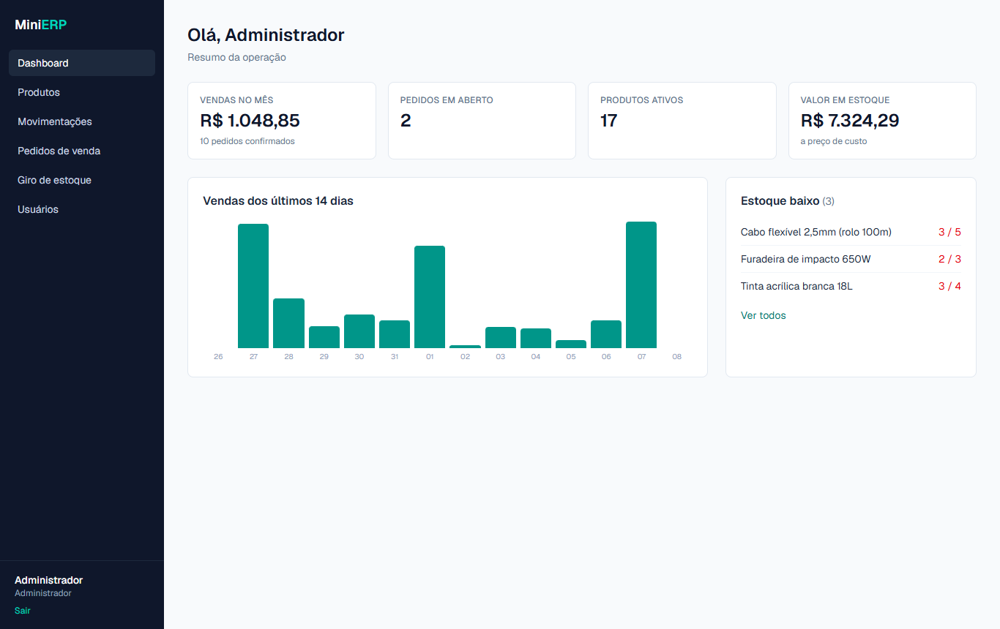

# Mini ERP — Estoque e Pedidos

Sistema web para controle de estoque e pedidos de venda de uma pequena empresa (pensei numa loja de materiais de construção). Cobre cadastro de produtos, entradas e saídas de estoque, pedidos de venda com baixa automática e um relatório de giro de estoque.

## Stack

**Backend:** ASP.NET Core 10 (Minimal APIs), EF Core 10, PostgreSQL, FluentValidation, JWT
**Frontend:** Next.js 16 (App Router), TypeScript, TanStack Query, Tailwind CSS

## Funcionalidades

- **Produtos:** cadastro com SKU único, categoria, preço de venda, estoque mínimo e **custo médio ponderado**, recalculado a cada entrada
- **Movimentações:** entradas e saídas manuais. Cada movimento guarda o saldo resultante, o que dá um histórico auditável por produto
- **Pedidos de venda:** um pedido pode ser salvo em aberto ou confirmado. Ao confirmar, o estoque é baixado automaticamente e o custo do momento fica registrado no item. Cancelar um pedido confirmado estorna o estoque
- **Relatório de giro:** quantidade vendida ÷ estoque médio do período, CMV e dias de cobertura, com filtros por período, categoria e produto
- **Dashboard:** vendas do mês, gráfico dos últimos 14 dias e produtos abaixo do mínimo
- **Usuários e perfis:** Admin, Vendedor e Estoquista, cada um com as permissões definidas abaixo

Todas as listagens têm **paginação, filtros e ordenação no servidor**.

### Perfis de acesso

| Recurso                    | Admin | Vendedor | Estoquista |
| -------------------------- | :---: | :------: | :--------: |
| Consultar produtos         |   ✓   |    ✓     |     ✓      |
| Cadastrar/editar produtos  |   ✓   |          |     ✓      |
| Movimentações de estoque   |   ✓   |          |     ✓      |
| Pedidos de venda           |   ✓   | ✓ (só os próprios) |    |
| Relatório de giro          |   ✓   |          |     ✓      |
| Usuários                   |   ✓   |          |            |

## Arquitetura

O backend usa **Vertical Slice**: em vez de separar o código em camadas (Controllers / Services / Repositories), cada feature fica numa pasta própria com seus endpoints, requests, validators e handlers.